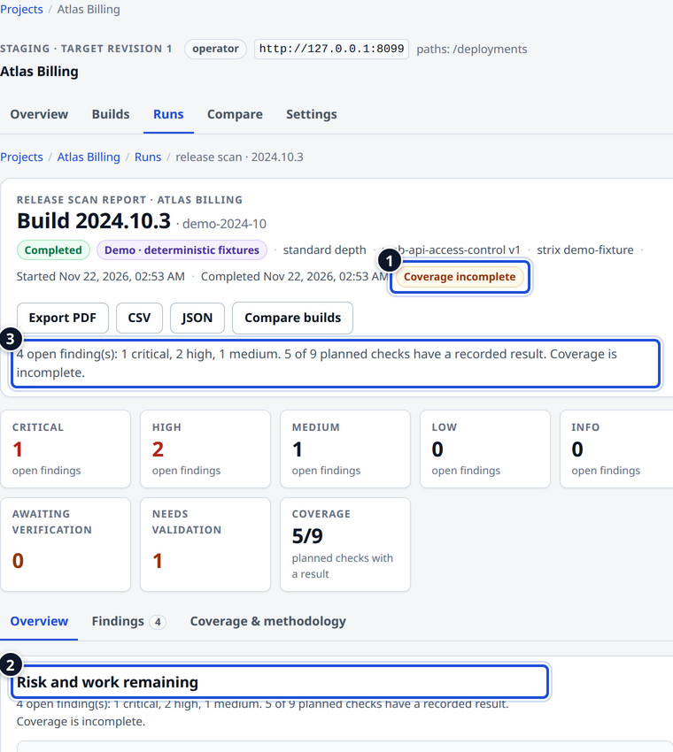

# Read a run report

Use this page when a run has reached a terminal status and you need to understand its result.

## Overview

The overview states the run's scope, status, counts, and limitations. Read **Risk and work
remaining** before the finding count. A report with no open findings can still have incomplete
coverage; the notice says which condition applies.

**Figure 1.** 1 is **Coverage incomplete**; 2 is **Risk and work remaining**; 3 is the open-finding summary. A zero finding count is only a clean result when coverage is complete.

## Findings

The **Findings** tab lists findings recorded from this run's snapshot. A finding is a claim with
evidence and a verification history, not a live status. Open a finding to inspect proof,
reproduction, evidence, and later retests.

## Coverage and methodology

**Coverage & methodology** explains what was planned, tested, blocked, not run, not applicable,
or needs review. Coverage counts planned checks with a recorded result. Reaching a route during
recon only adds it to the surface inventory; it is not a tested check.

## What the counts mean

- **Tested no finding** means a check ran and did not record a finding.
- **Finding observed** means a check recorded a finding.
- **Blocked** means a required prerequisite prevented the check.
- **Not run** means the planned check has no result.
- **Needs review** means the evidence or result requires a human decision.

Do not add “tested” and “finding observed” and call the total “all checks.” The denominator is the
planned row count, and some rows may be blocked or not applicable.

## Latest verification

**Latest verification** shows evidence recorded after the run snapshot. It is deliberately
separate from the frozen comparison; a later retest can change your understanding without
rewriting the historical report.

## Run provenance

The header records the build, mode, depth, profile version, engine version, timestamps, and
coverage-complete flag. Use those fields in tickets and exports so another person can identify
the exact snapshot.

## Zero findings

Zero findings is not automatically a clean result. Read the coverage-complete badge and the
limitations. If coverage is incomplete, say “no findings in the tested checks,” not “the target
is clean.” See [Limits](/guide/limits).
