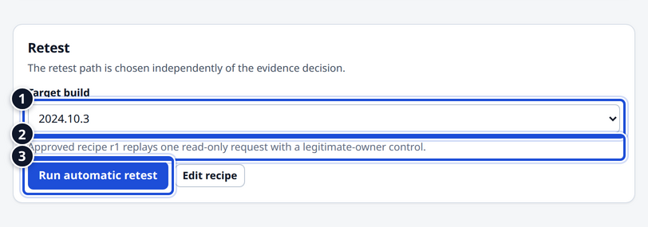

# Retest a finding

Use this page when a fix or a new build needs to be checked against an existing finding.

**Who can do this:** developers can submit evidence and retests; operators can edit recipes,
review guided submissions, and accept a verdict.

## Choose the retest path

The finding page selects one of three paths:

- **Automatic** uses an approved recipe to replay one constrained read-only request with an
  owner positive control.
- **Guided** provides a package of steps for a person to perform and submit.
- **Pending evidence review** means the proof must be reviewed before a retest is scheduled.

The path is independent of the evidence decision. A pending review does not mean the finding is
false.

**Figure 1.** 1 selects the target build; 2 explains the approved replay and owner control; 3 starts the automatic retest. A pending evidence review uses the guided path instead.

## Automatic replay

1. Choose the **Target build**.
2. Select **Run automatic retest**.
3. Wait for the attempt to complete.
4. Read the recorded observation and its evidence.

The server refuses to queue a replay when the recipe is missing, the requester lost access, the
current target policy no longer allows the destination, or the finding's scope is stale. Those
are safety checks, not transient errors.

## Guided retest

Open the guided package from the finding. Perform the listed steps on the selected build,
capture the evidence, and submit it for review. If the steps do not match the deployment, use
**Revise guided steps** to create a new revision; do not silently change the original.

The operator reviews the submission and accepts or rejects the verdict. The build verdict does
not change while the submission is pending.

## Review evidence

Use the review panel to inspect the submitted evidence, the actor, and the stated reason. Accept
only when the evidence supports the claimed outcome. A rejection must include a reason so the
next reviewer can understand the gap.

## Accept or reject a verdict

**Accept verdict** records the reviewer's decision on a pending guided attempt. The server
enforces operator/admin capability for acceptance. If the button is missing, your role is the
reason.

## Mark ready for retest

A developer can mark an open finding **Mark ready for retest** after the fix is deployed. This
does not change the verification outcome; it makes the retest workflow available.

## Change disposition

**Disposition** records `open`, `false_positive`, or `duplicate` with a reason. Disposition is a
review decision, not a replacement for verification history. Use it when the finding is not a
valid defect or is already represented by another finding.
