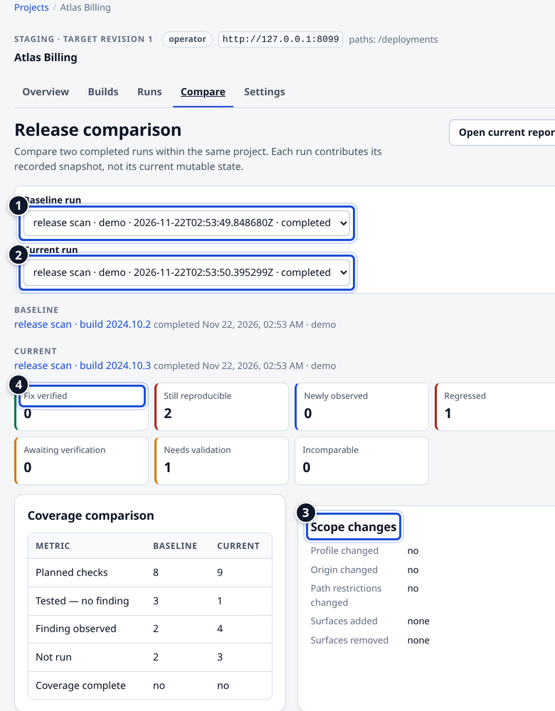

# Compare two releases

Use this page when you have two completed runs of the same project and want to see what changed.

## Pick the two runs

1. Open **Project → Compare**.
2. Choose a **Baseline run** and a **Current run**.
3. Choose **Compare**.

Both runs must be completed. The baseline defaults to the previous same-mode run, and selecting
the same run twice is rejected. A demo run and a live run are not comparable.

**Figure 1.** 1 is the baseline run; 2 is the current run; 3 is **Scope changes**; 4 is the bucket grid. Read the scope warning before treating a bucket as a fix or regression.

## Buckets

Table: Comparison bucket meanings
| Bucket | Meaning |
| --- | --- |
| fix_verified | A conclusive retest on the current build did not reproduce the finding. |
| still_reproducible | The current build still shows the finding. |
| newly_observed | The current run observed a finding that was not in the baseline. |
| regressed | A previously fixed finding is reproducible again. |
| awaiting_verification | The finding exists but has no conclusive retest yet. |
| needs_validation | The evidence is not strong enough for a verdict. |
| incomparable | Scope or evidence differences make the comparison unsafe. |

Each comparable finding receives one primary bucket. Read the scope changes and limitations
before using a bucket in a release decision.

## Scope limitations

**Scope changes** lists differences in the target, identities, build, or run plan. A change can
make a comparison incomplete even when both runs completed. **Comparison is limited** means the
app cannot claim a valid fix or regression.

## Coverage comparison

The coverage table shows changes in planned, tested, blocked, and not-run checks. A lower
finding count with worse coverage is not a security improvement; it may be missing tests.

## Latest verification

The bottom panel shows evidence recorded after the selected snapshots. It is not part of the
frozen comparison. Use it to understand a later retest, not to rewrite the historical release
comparison.
