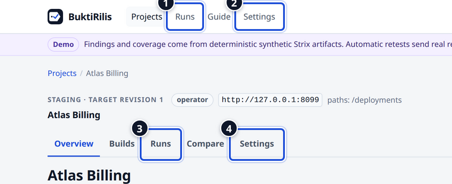

# Where things live

Use this page when a label appears in two places or a screen seems missing.

## Top navigation

Table: Top navigation destinations
| Label | Destination | What it is |
| --- | --- | --- |
| Projects | `/projects` | All projects you can access. |
| Runs | `/runs` | Recent assessments across your projects. |
| Guide | `/guide` | This guide. |
| Settings | `/settings` | Installation settings and worker status. |
| Admin | `/admin` | Accounts, all projects, and installation audit, for administrators. |

Top-bar **Settings** is not the same as **Project → Settings**. The top-bar page is
installation-wide; the project tab is scope, identities, members, and audit for one project.

## Project tabs

Table: Project sections
| Tab | What it is |
| --- | --- |
| Overview | Project summary, recent runs, approved scope, and next actions. |
| Builds | Register a build and attest an identity. |
| Runs | Queue and inspect runs for this project. |
| Compare | Compare two completed runs. |
| Settings | Target policy, OpenAPI revision, test identities, audit, membership, execution settings. |

**Figure 1.** 1 is the top-bar **Runs** list; 2 is installation **Settings**; 3 is this project's **Runs**; 4 is this project's **Settings**. The labels repeat, but the scope does not.

There is no top-level **Builds** page. Builds live inside a project. There is also no delete
action for a project, build, or run; the history is retained.

## Report tabs

A run opens as a **report**; there is no `/reports` page.

Table: Report sections
| Section | What it is |
| --- | --- |
| Overview | Risk, work remaining, counts, latest verification, provenance. |
| Findings | Findings recorded in this run's snapshot. |
| Coverage & methodology | Planned and actual checks, gaps, and completeness. |

## Finding page

The finding page contains **Proof summary**, **Prerequisites and reproduction**, **Evidence**,
**Verification history**, **Assessment state**, **Retest**, and **Links**. A finding opened from a
run keeps the run context in its breadcrumbs.

## Administration versus project membership

- **Admin** creates accounts and projects and shows the installation audit.
- **Project → Settings → Membership** adds an existing user to one project with a project role.
- **Project → Settings → Test identities** stores target credentials, not app user accounts.

## A link that does not resolve

If a guide link or an app deep link no longer resolves, the app is authoritative. Report the
mismatch with the screen and the link; see
[The guide and the screen disagree](/guide/troubleshooting#the-guide-and-the-screen-disagree).
